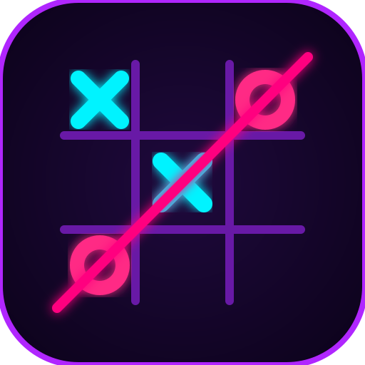

# ⚡ Neon Tic Tac Toe & 2-Player Glow

Görseldeki popüler neon arcade mobil oyununun birebir tasarım ve fonksiyonel replikası! Hem telefonlarda hem tablet ve bilgisayarlarda kusursuz çalışan, ses sentezleyicili, yapay zekalı ve çevrimiçi çok oyunculu modern web uygulaması.



---

## ✨ Özellikler

1. **Görsel Tasarım (Birebir Replikasyon):**
   - Retrowave 3D hareketli neon ızgara ve ufuk parlaması (Synthwave Grid)
   - HK7 kullanıcı profili (Avatar, Kullanıcı Adı, Cinsiyet sembolü ve Biyografi düzenlenebilir)
   - Home ve 2-Player üst sekmeleri
   - Işıltılı neon oyun kartları:
     - 🎮 **Tic Tac Toe (Play)** (X & O Neon ızgara ve vuruş çizgisi)
     - 🔷 **Stack Six**
     - 🐱 **Tomb Run**
     - ⚖️ **Balance Drop**
     - 💘 **Arrow Puzzle** (NEW! Rozetli)
     - 🧪 **Water sort**
   - Alt kaydırma oku, Gizlilik Politikası ve Kullanıcı Sözleşmesi pencereleri
   - Liderlik tablosu (Kazanma, Kaybetme, Beraberlik ve Yüzde oranı)
   - Reklamsız VIP rozet ekranı

2. **Oyun Modları:**
   - 🤖 **Bota Karşı (Vs AI):**
     - **Kolay:** Rastgele eğlenceli hamleler.
     - **Orta:** Fırsatları değerlendirir, bazen hata yapar.
     - **İmkansız (Minimax):** Asla yenilmeyen akıllı yapay zeka algoritması!
   - 👥 **Yan Yana (Pass & Play):** Aynı telefonda sırayla dokunarak arkadaşınla oyna.
   - 🔄 **Yüzyüze Düello (Tabletop Inverted):** Telefonu masaya koyduğunuzda 2. oyuncunun ekranı ters döner (180°), böylece karşılıklı oturan iki arkadaş telefon çevirmeden doğal olarak oynayabilir.
   - 🌐 **Online P2P Çok Oyunculu:**
     - 5 haneli oda kodu oluştur veya arkadaşının kodunu gir.
     - WebRTC Peer-to-Peer ile sunucu maliyeti olmadan sıfır gecikmeli gerçek zamanlı oyun!
     - Canlı emoji gönderme ve rövanş (tekrar oyna) desteği.

3. **Tahta Boyutları:**
   - **3x3 Klasik:** 3'lü yapan kazanır.
   - **5x5 Geniş:** 4'lü yapan kazanır.

4. **Ses ve Hissiyat (Web Audio & Haptics):**
   - Web Audio API ile dahili üretilen lazer vuruşları, zafer arpejleri ve retro synth sesleri (hiçbir harici mp3'e ihtiyaç duymaz, internetsiz ve sıfır hata ile çalar).
   - Arka plan 80'ler synthwave ritim müziği (isteğe bağlı açılıp kapatılabilir).
   - Telefon titreşimi (Haptic feedback).
   - Zaferde renkli neon konfeti patlaması!

5. **Mobil & PWA:**
   - Çift tıklama yakınlaştırması engellenmiş, 100dvh tam ekran mobil uyumlu.
   - Ana ekrana uygulama olarak eklenebilir (PWA manifest ve standalone görünüm).

---

## 🚀 Vercel'de Yayınlama Rehberi

Bu proje **Vite + React** tabanlı olduğu için Vercel ile %100 uyumludur. Hazır `vercel.json` dosyası içerir.

### Yöntem 1: GitHub Üzerinden Vercel (En Kolay)
1. Bu klasördeki dosyaları kendi GitHub hesabınıza bir repository olarak yükleyin:
   ```bash
   git init
   git add .
   git commit -m "Neon Tic Tac Toe İlk Sürüm"
   git remote add origin https://github.com/KULLANICI_ADINIZ/neon-tic-tac-toe.git
   git push -u origin main
   ```
2. [Vercel](https://vercel.com) hesabınıza giriş yapın.
3. **"Add New Project"** butonuna tıklayın ve GitHub reposunu seçin.
4. Framework olarak otomatik `Vite` algılanacaktır. **Deploy** butonuna basın!
5. 30 saniye içinde siteniz `https://neon-tic-tac-toe.vercel.app` gibi bir adreste canlıya geçer!

### Yöntem 2: Vercel CLI ile Terminalden Doğrudan Yayınlama
Terminalden proje klasöründe şu komutu çalıştırabilirsiniz:
```bash
npx vercel
```
Gelen soruları `Enter` ile onaylayarak doğrudan yayına alabilirsiniz!

---

## 💻 Yerel Geliştirme (Localhost)

Projeyi kendi bilgisayarınızda çalıştırmak için:
```bash
# Bağımlılıkları yükleyin
npm install

# Geliştirme sunucusunu başlatın
npm run dev

# Üretim derlemesi (Build) alın
npm run build
```
Ardından tarayıcınızda veya telefonunuzda açılan adrese gidin.
